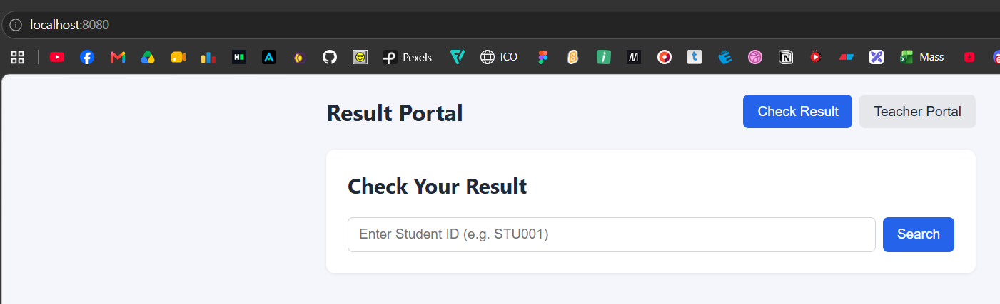
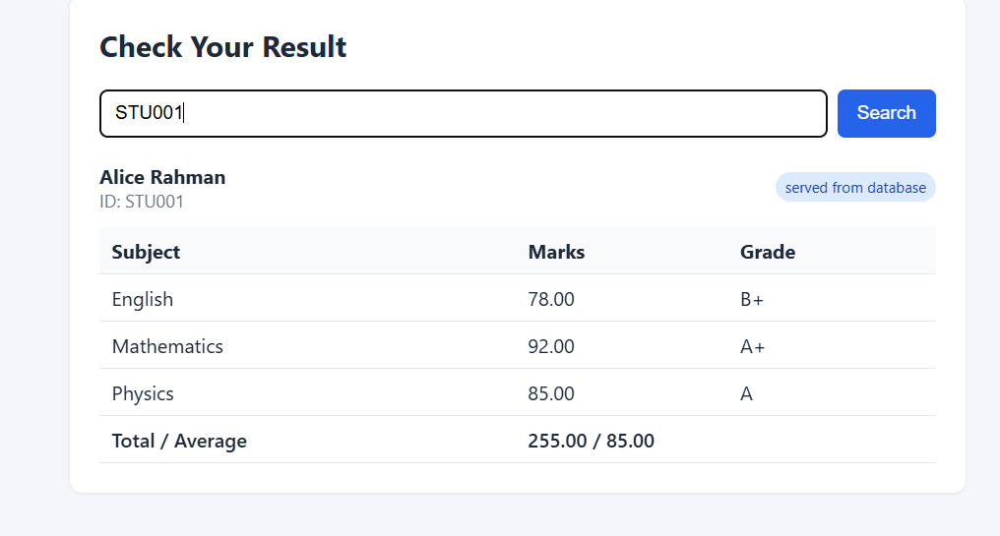
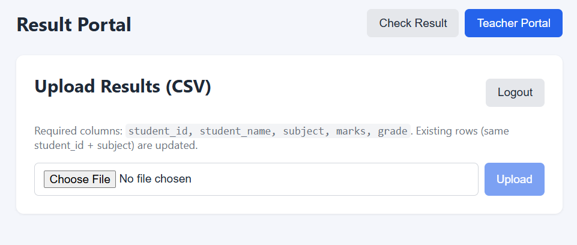
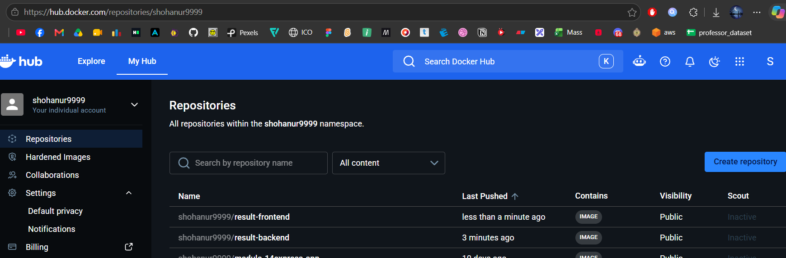

# Assignment 15 — Three-Tier Kubernetes Deployment

Result Publishing App on **Docker Desktop Kubernetes**: React/Nginx frontend,
Django backend, PostgreSQL, and Redis.

> **NOTE: I do not currently have an AWS account, so this assignment was
> completed and verified on Docker Desktop Kubernetes instead of AWS/EKS.**

| | |
|---|---|
| **App URL** | <http://localhost/> |
| **Health** | <http://localhost/api/health/> |
| **Namespaces** | `app`, `db-production` |
| **Images** | `localhost:5000/result-backend:latest`, `localhost:5000/result-frontend:latest` |
| **Status** | Deployed and verified — health returns `{"status":"ok","database":"ok","redis":"ok"}` |

> Real credentials are **not** included in this submission. See
> [Credentials](#credentials).

## Architecture

```text
Browser
  │  http://localhost/
  ▼
ingress-nginx (app namespace)
  └── /            → frontend Service (Nginx + React)
                        ├── /                 → React SPA
                        └── /api, /admin, /static
                                              → backend Service (Django + gunicorn)

backend ──► postgres.db-production.svc.cluster.local:5432
        └─► redis.app.svc.cluster.local:6379
```

| Resource | Namespace | Kind |
|---|---|---|
| frontend | `app` | Deployment + ClusterIP Service |
| backend | `app` | Deployment + ClusterIP Service |
| django-migrate | `app` | Job (migrations + teacher account) |
| redis | `app` | StatefulSet + headless/ClusterIP Services + PVC |
| postgres | `db-production` | StatefulSet + headless/ClusterIP Services + PVC |
| ingress | `app` | Ingress (`host: localhost`) |

## Validate in 5 minutes

If the cluster is still running, run:

```bash
kubectl get pods -n app
kubectl get pods -n db-production
kubectl get pvc -n app
kubectl get pvc -n db-production
kubectl get svc,endpoints -n app
kubectl get ingress -n app
curl -sS http://localhost/api/health/
```

Expected:

- `backend`, `frontend`, and `redis-0` are `1/1` in `app`.
- `postgres-0` is `1/1` in `db-production`.
- The `django-migrate` Job is `Complete`.
- Both PVCs are `Bound`; Service Endpoints are populated.
- The Ingress has host `localhost`.
- Health returns `{"status":"ok","database":"ok","redis":"ok"}`.

Browser check: open <http://localhost/>, search `STU001` twice, and log in to
the **Teacher Portal** with username `teacher` (password is not included; see
[Credentials](#credentials)).

## Rubric checklist

| Requirement | Status | Proof |
|---|---|---|
| Dedicated namespaces and persistent storage | Done | [Cluster and storage class](#cluster-and-storage-class), [Storage](#storage) |
| Backend and frontend images built and published | Done | [Images published](#images-published) |
| ConfigMaps and Secrets; credentials not in source control | Done | [Workloads](#workloads-and-probes); `.env` files are gitignored |
| PostgreSQL and Redis StatefulSets with headless Services and PVCs | Done | [Workloads](#workloads-and-probes), [Storage](#storage) |
| Redis persistence enabled; data services internal | Done | `--appendonly yes`; ClusterIP Services |
| Django Deployment + internal Service + migrations + teacher account | Done | [Workloads](#workloads-and-probes) |
| Readiness probe configured for backend | Done | [Workloads](#workloads-and-probes) |
| Frontend Deployment + Service + browser access | Done | [Workloads](#workloads-and-probes), [Screenshots](#screenshots) |
| Workloads, Service Endpoints, and PVCs verified | Done | [Workloads](#workloads-and-probes), [Services](#services-endpoints-and-ingress), [Storage](#storage) |
| Health endpoint verified through the frontend | Done | [Health](#health) |
| Teacher login and sample CSV upload | Done | [Teacher login and CSV upload](#teacher-login-and-csv-upload), screenshot 3 |
| Second student lookup served from cache | Done | [Cache behaviour](#cache-behaviour), screenshots 1–2 |
| PostgreSQL Pod recreated and data still available | Done | [Persistence](#persistence) |
| Manifests, README, and redacted evidence in `submits/` | Done | This folder |

## Screenshots

The images are in [`images/`](images/). If one does not render below, open it
directly from that folder.

### Student lookup — served from database



### Second lookup — served from cache



### Teacher CSV upload



### Deployment and health validation



## Evidence

All evidence below was captured with `submits/scripts/verify.sh`. Credentials
and authentication tokens are redacted; Secret values are never printed.

### Images published

Both application images were built and published to the local registry that the
cluster pulls from.

```text
# Registry catalog
{"repositories":["result-backend","result-frontend"]}

# Published images
localhost:5000/result-frontend:latest 222669c3797e
localhost:5000/result-backend:latest 4897aa1b65e3
```

### Cluster and storage class

- Node `docker-desktop` is `Ready`.
- Default StorageClass: `hostpath` (dynamic PVC provisioning).
- Dedicated namespaces: `app` and `db-production`.

<details>
<summary>Full cluster output</summary>

```text
Client Version: v1.36.1
Kustomize Version: v5.8.1
Server Version: v1.36.1

# Nodes
NAME             STATUS   ROLES           AGE   VERSION   INTERNAL-IP    EXTERNAL-IP   OS-IMAGE         KERNEL-VERSION                              CONTAINER-RUNTIME
docker-desktop   Ready    control-plane   10d   v1.36.1   192.168.65.3   <none>        Docker Desktop   6.18.54.1-microsoft-standard-WSL2 (amd64)   docker://29.8.1

# StorageClasses
NAME                 PROVISIONER          RECLAIMPOLICY   VOLUMEBINDINGMODE   ALLOWVOLUMEEXPANSION   AGE
hostpath (default)   docker.io/hostpath   Delete          Immediate           false                  10d

# Namespaces
NAME              STATUS   AGE
app               Active   14m
db-production     Active   14m
default           Active   10d
ingress-nginx     Active   16m
kube-node-lease   Active   10d
kube-public       Active   10d
kube-system       Active   10d
production        Active   10d
```

</details>

### Workloads and probes

- Backend, frontend, Redis, and PostgreSQL: `1/1`, zero restarts.
- Migration Job `django-migrate`: `Complete` (`1/1`).
- ConfigMap `django-configmap`; Secrets `backend-secret` and
  `postgres-secret` (names only).
- Backend readiness probe: `GET /api/health/` on port `8000`.
- Redis persistence: `["redis-server","--appendonly","yes"]`.

<details>
<summary>Full workload output</summary>

```text
# Pods - app
NAME                        READY   STATUS      RESTARTS   AGE     IP          NODE             NOMINATED NODE   READINESS GATES
backend-6b5cf48b59-zbrpd    1/1     Running     0          6m48s   10.1.0.27   docker-desktop   <none>           <none>
django-migrate-8gd47        0/1     Completed   0          14m     10.1.0.21   docker-desktop   <none>           <none>
frontend-59749b7694-jgswr   1/1     Running     0          14m     10.1.0.20   docker-desktop   <none>           <none>
redis-0                     1/1     Running     0          14m     10.1.0.23   docker-desktop   <none>           <none>

# Pods - db-production
NAME         READY   STATUS    RESTARTS   AGE    IP          NODE             NOMINATED NODE   READINESS GATES
postgres-0   1/1     Running   0          118s   10.1.0.29   docker-desktop   <none>           <none>

# Deployments, StatefulSets, Jobs - app
NAME                       READY   UP-TO-DATE   AVAILABLE   AGE
deployment.apps/backend    1/1     1            1           14m
deployment.apps/frontend   1/1     1            1           14m

NAME                     READY   AGE
statefulset.apps/redis   1/1     14m

NAME                       STATUS     COMPLETIONS   DURATION   AGE
job.batch/django-migrate   Complete   1/1           96s        14m

# StatefulSets - db-production
NAME       READY   AGE
postgres   1/1     14m

# ConfigMaps - app
NAME               DATA   AGE
django-configmap   7      14m
kube-root-ca.crt   1      14m

# Secrets (names/types only)
NAME             TYPE     DATA   AGE
backend-secret   Opaque   7      14m
NAME              TYPE     DATA   AGE
postgres-secret   Opaque   3      14m

# Backend readiness probe
{"failureThreshold":3,"httpGet":{"path":"/api/health/","port":8000,"scheme":"HTTP"},"initialDelaySeconds":5,"periodSeconds":10,"successThreshold":1,"timeoutSeconds":1}

# Redis persistence arguments
["redis-server","--appendonly","yes"]
```

</details>

<details>
<summary>Migration Job logs — migrations and teacher account</summary>

```text
Defaulted container "migrate" out of: migrate, wait-for-postgres (init)
Applying database migrations...
Operations to perform:
  Apply all migrations: admin, auth, authtoken, contenttypes, results, sessions
Running migrations:
  Applying contenttypes.0001_initial... OK
  Applying auth.0001_initial... OK
  Applying admin.0001_initial... OK
  Applying admin.0002_logentry_remove_auto_add... OK
  Applying admin.0003_logentry_add_action_flag_choices... OK
  Applying contenttypes.0002_remove_content_type_name... OK
  Applying auth.0002_alter_permission_name_max_length... OK
  Applying auth.0003_alter_user_email_max_length... OK
  Applying auth.0004_alter_user_username_opts... OK
  Applying auth.0005_alter_user_last_login_null... OK
  Applying auth.0006_require_contenttypes_0002... OK
  Applying auth.0007_alter_validators_add_error_messages... OK
  Applying auth.0008_alter_user_username_max_length... OK
  Applying auth.0009_alter_user_last_name_max_length... OK
  Applying auth.0010_alter_group_name_max_length... OK
  Applying auth.0011_update_proxy_permissions... OK
  Applying auth.0012_alter_user_first_name_max_length... OK
  Applying authtoken.0001_initial... OK
  Applying authtoken.0002_auto_20160226_1747... OK
  Applying authtoken.0003_tokenproxy... OK
  Applying authtoken.0004_alter_tokenproxy_options... OK
  Applying results.0001_initial... OK
  Applying sessions.0001_initial... OK
Superuser created successfully.
Teacher account 'teacher' created.
Starting: echo Migrations done.
Migrations done.
```

</details>

### Services, endpoints, and ingress

The data Services are internal (ClusterIP/headless). The frontend and backend
Services have populated Endpoints, and the Ingress exposes the app on
`localhost`.

<details>
<summary>Full Services, Endpoints, and Ingress output</summary>

```text
# Services - app
NAME             TYPE        CLUSTER-IP       EXTERNAL-IP   PORT(S)    AGE
backend          ClusterIP   10.106.212.196   <none>        8000/TCP   14m
frontend         ClusterIP   10.101.160.89    <none>        80/TCP     14m
redis            ClusterIP   10.96.80.101     <none>        6379/TCP   14m
redis-headless   ClusterIP   None             <none>        6379/TCP   14m

# Services - db-production
NAME                TYPE        CLUSTER-IP       EXTERNAL-IP   PORT(S)   AGE
postgres            ClusterIP   10.102.216.125   <none>        5432/TCP  14m
postgres-headless   ClusterIP   None             <none>        5432/TCP  14m

# Endpoints - app
NAME             ENDPOINTS        AGE
backend          10.1.0.27:8000   14m
frontend         10.1.0.20:80     14m
redis            10.1.0.23:6379   14m
redis-headless   10.1.0.23:6379   14m

# Endpoints - db-production
NAME                ENDPOINTS        AGE
postgres            10.1.0.29:5432   14m
postgres-headless   10.1.0.29:5432   14m

# Ingress - app
NAME          CLASS   HOSTS       ADDRESS     PORTS   AGE
app-ingress   nginx   localhost   localhost   80      14m

# ingress-nginx controller Service
NAME                                 TYPE           CLUSTER-IP      EXTERNAL-IP   PORT(S)                      AGE
ingress-nginx-controller             LoadBalancer   10.111.79.62    localhost     80:31507/TCP,443:31738/TCP   16m
ingress-nginx-controller-admission   ClusterIP      10.97.242.201   <none>        443/TCP                      16m
```

</details>

### Storage

Redis and PostgreSQL each have a dynamically provisioned, bound PVC.

- `data-redis-0` — `Bound`, 1Gi, StorageClass `hostpath`.
- `data-postgres-0` — `Bound`, 1Gi, StorageClass `hostpath`.

<details>
<summary>Full PVC and PV output</summary>

```text
# PVCs - app
NAME           STATUS   VOLUME                                     CAPACITY   ACCESS MODES   STORAGECLASS   VOLUMEATTRIBUTESCLASS   AGE
data-redis-0   Bound    pvc-eccd0a08-bb31-4175-b07c-14adf5ce8b81   1Gi        RWO            hostpath       <unset>                 14m

# PVCs - db-production
NAME              STATUS   VOLUME                                     CAPACITY   ACCESS MODES   STORAGECLASS   VOLUMEATTRIBUTESCLASS   AGE
data-postgres-0   Bound    pvc-d1945c56-2b0b-401c-8d40-6c4704b5a124   1Gi        RWO            hostpath       <unset>                 14m

# PersistentVolumes
NAME                                       CAPACITY   ACCESS MODES   RECLAIM POLICY   STATUS   CLAIM                           STORAGECLASS   VOLUMEATTRIBUTESCLASS   REASON   AGE
pvc-d1945c56-2b0b-401c-8d40-6c4704b5a124   1Gi        RWO            Delete           Bound    db-production/data-postgres-0   hostpath       <unset>                          14m
pvc-eccd0a08-bb31-4175-b07c-14adf5ce8b81   1Gi        RWO            Delete           Bound    app/data-redis-0                hostpath       <unset>                          14m
```

</details>

### Health

The browser entry point goes through ingress-nginx to the frontend Nginx, which
proxies `/api/` to the Django backend.

```text
# GET http://localhost/api/health/  (ingress -> frontend Nginx -> backend)
{"status":"ok","database":"ok","redis":"ok"}

# GET http://localhost/  (React SPA through ingress -> frontend)
HTTP 200
```

### Teacher login and CSV upload

The teacher authenticates and uploads the sample CSV. The token is redacted.

```text
# POST http://localhost/api/auth/login/ (token redacted)
{"token":"<REDACTED>"}

# POST http://localhost/api/results/upload/ (backend/sample_results.csv)
{"created":9,"updated":0,"students_affected":3,"errors":[]}
```

### Cache behaviour

The upload cleared the affected cache key, so the first lookup reads PostgreSQL
and the second lookup is served from Redis.

```text
# First lookup (expected: source = database)
{"student_id":"STU001","student_name":"Alice Rahman","subjects":[{"subject":"English","marks":"78.00","grade":"B+"},{"subject":"Mathematics","marks":"92.00","grade":"A+"},{"subject":"Physics","marks":"85.00","grade":"A"}],"total_marks":"255.00","average":"85.00","source":"database"}

# Second lookup (expected: source = cache)
{"student_id":"STU001","student_name":"Alice Rahman","subjects":[{"subject":"English","marks":"78.00","grade":"B+"},{"subject":"Mathematics","marks":"92.00","grade":"A+"},{"subject":"Physics","marks":"85.00","grade":"A"}],"total_marks":"255.00","average":"85.00","source":"cache"}

# Redis keys
:1:health:ping
:1:result:STU001
```

### Persistence

The PostgreSQL Pod was deleted and recreated. The PVC stayed the same, Redis
was flushed, and the next lookup still returned the same student data from
PostgreSQL.

- PostgreSQL Pod: `postgres-0` recreated.
- PVC before and after: `data-postgres-0`
  (`pvc-d1945c56-2b0b-401c-8d40-6c4704b5a124`).
- Lookup after recreation: `source: database`.
- Row count after recreation: `9`.

<details>
<summary>Full persistence output</summary>

```text
# PostgreSQL pod before deletion
NAME         READY   STATUS    RESTARTS   AGE    IP          NODE             NOMINATED NODE   READINESS GATES
postgres-0   1/1     Running   0          2m5s   10.1.0.29   docker-desktop   <none>           <none>

# PVC before deletion
NAME              STATUS   VOLUME                                     CAPACITY   ACCESS MODES   STORAGECLASS   VOLUMEATTRIBUTESCLASS   AGE
data-postgres-0   Bound    pvc-d1945c56-2b0b-401c-8d40-6c4704b5a124   1Gi        RWO            hostpath       <unset>                 14m

# Deleting postgres-0
pod "postgres-0" deleted from db-production namespace

# Waiting for the StatefulSet to recover
Waiting for 1 pods to be ready...
partitioned roll out complete: 1 new pods have been updated...

# PostgreSQL pod after recovery
NAME         READY   STATUS    RESTARTS   AGE   IP          NODE             NOMINATED NODE   READINESS GATES
postgres-0   1/1     Running   0          13s   10.1.0.30   docker-desktop   <none>           <none>

# PVC after recovery (same volume)
NAME              STATUS   VOLUME                                     CAPACITY   ACCESS MODES   STORAGECLASS   VOLUMEATTRIBUTESCLASS   AGE
data-postgres-0   Bound    pvc-d1945c56-2b0b-401c-8d40-6c4704b5a124   1Gi        RWO            hostpath       <unset>                 14m

# Flushing Redis so the next lookup must read PostgreSQL
OK

# Lookup after pod recreation (expected: source = database, same marks)
{"student_id":"STU001","student_name":"Alice Rahman","subjects":[{"subject":"English","marks":"78.00","grade":"B+"},{"subject":"Mathematics","marks":"92.00","grade":"A+"},{"subject":"Physics","marks":"85.00","grade":"A"}],"total_marks":"255.00","average":"85.00","source":"database"}

# Row count in PostgreSQL
 count
-------
     9
(1 row)
```

</details>

## Deploy from scratch

Full manual steps without helper scripts: [`MANUAL_STEPS.md`](MANUAL_STEPS.md).

With the helper script:

```bash
cp k8s/postgres.env.example k8s/postgres.env
cp k8s/backend.env.example k8s/backend.env
# Edit both files; use the same POSTGRES_PASSWORD in each.
./submits/scripts/deploy.sh
```

The script starts the local registry, builds and pushes both images, installs
ingress-nginx if needed, applies `k8s/`, and waits for PostgreSQL, the migration
Job, and both application Deployments.

## Credentials

- Real `k8s/backend.env` and `k8s/postgres.env` are gitignored and are **not**
  part of this submission.
- Only `submits/manifests/backend.env.example` and
  `submits/manifests/postgres.env.example` are included.
- Teacher username: `teacher`.
- The teacher password is intentionally not included; set it through
  `DJANGO_SUPERUSER_PASSWORD` in `k8s/backend.env` when deploying.
- The authentication token in the evidence above is redacted.

## Submission contents

```text
submits/
  README.md          this file
  MANUAL_STEPS.md    step-by-step manual deployment and verification
  images/            browser and deployment screenshots
  manifests/         final Kubernetes manifests and env examples
  scripts/           deploy.sh, verify.sh, cleanup.sh
```
